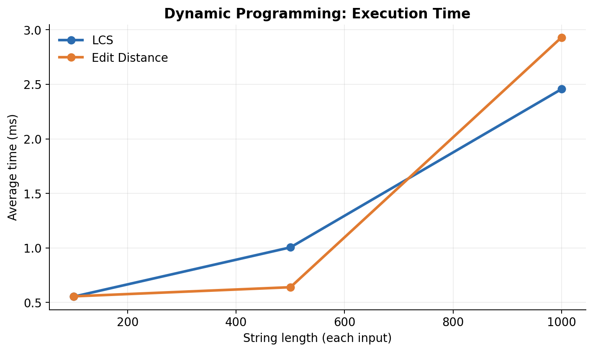
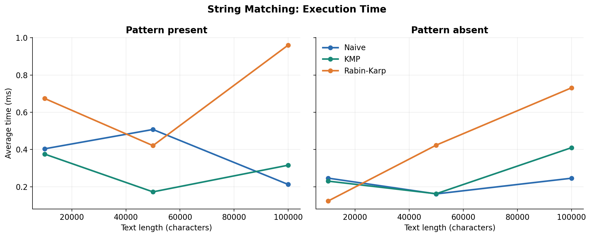

# Assignment 4 - Text Analysis

This Java project implements dynamic programming and string algorithms, tests their correctness, and compares their performance.

## Algorithms

- **LCS:** returns the length of the longest common subsequence of two strings.
- **Edit Distance:** returns the minimum number of insertions, deletions, and substitutions required to transform one string into another.
- **Naive Matching:** checks every possible starting position in the text.
- **KMP:** uses an LPS (longest proper prefix which is also a suffix) table to avoid rechecking text characters.
- **Rabin-Karp:** compares rolling hashes and verifies actual characters whenever hashes match.
- **Kasai:** produces the LCP (longest common prefix) array from a string and a supplied suffix array.

## Project Structure

```text
src/
  Algorithms.java
  Tests.java
  Experiments.java
plots/
  dp.png
  string_matching.png
results.csv
README.md
```

Java 17 or newer is required. From the project directory, run:

```bash
javac -d out src/*.java
java -cp out Tests
java -cp out Experiments
```

To save a new set of experimental measurements:

```bash
java -cp out Experiments > results.csv
```

## Implementation and Assumptions

Both dynamic programming algorithms use a full two-dimensional table. LCS initializes the empty-prefix row and column to zero. Edit Distance initializes them with the number of characters that must be inserted or deleted.

Matching returns **all zero-based starting indices**, including overlapping occurrences. Matching is case-sensitive. An empty pattern matches at every position, including the end of the text: for `"abc"`, the result is `[0, 1, 2, 3]`. A nonempty pattern longer than the text produces an empty list. Inputs are assumed to be non-null.

KMP builds the LPS table before searching. Rabin-Karp uses base 256 and modulus 1,000,000,007. A hash match is always followed by direct character comparison, so collisions cannot create false matches.

For Kasai, the suffix array is supplied as input. The experiments construct a suffix array using ordinary sorting **before** timing Kasai. Suffix-array construction is not part of the measured time.

## Dynamic Programming Recurrences

Let `L(i,j)` be the LCS length of the first `i` and `j` characters:

- Base cases: `L(0,j) = L(i,0) = 0`.
- If the last characters match: `L(i,j) = 1 + L(i-1,j-1)`.
- Otherwise: `L(i,j) = max(L(i-1,j), L(i,j-1))`.

When the last characters match, they can extend the smaller common subsequence. Otherwise at least one of these characters is not used in an optimal subsequence, so checking both possibilities gives the optimum.

Let `D(i,j)` be the Edit Distance between the first `i` and `j` characters:

- Base cases: `D(i,0) = i` and `D(0,j) = j`.
- If the last characters match: `D(i,j) = D(i-1,j-1)`.
- Otherwise: `D(i,j) = 1 + min(D(i-1,j), D(i,j-1), D(i-1,j-1))`.

The three candidates are deletion, insertion, and substitution. Every valid final edit is one of these operations, so selecting the cheapest option builds the optimal answer.

## Complexity Analysis

Here `n` and `m` are string or text and pattern lengths. For Kasai, `n` is the string length. Output storage for the `k` reported matches adds `O(k)` to all matching algorithms.

| Algorithm | Main recurrence / operation | Best time | Worst time | Auxiliary space | Reason |
|---|---|---|---|---|---|
| LCS | DP match or max of two neighbors | O(nm) | O(nm) | O(nm) | Fills every table cell. |
| Edit Distance | DP min of three edits | O(nm) | O(nm) | O(nm) | Fills every table cell. |
| Naive | Compare pattern at each shift | O(n + m) | O(nm) | O(1) | Usually stops at the first mismatch; repeating text can force many comparisons. |
| KMP | Build LPS, then follow LPS on mismatch | O(n + m) | O(n + m) | O(m) | Preprocessing is O(m), and the scan is O(n). |
| Rabin-Karp | Rolling hash and collision verification | Expected O(n + m) | O(nm) | O(1) | Updating a hash takes O(1); many matching hashes can force O(m) verification per shift. |
| Kasai | Reuse previous LCP length using rank | O(n) | O(n) | O(n) | The matched-prefix counter increases and decreases at most O(n) times overall. |

The best-case Naive bound assumes a nonempty pattern and that every candidate position fails quickly. KMP's preprocessing takes O(m) and its search takes O(n). Rabin-Karp has O(m) preprocessing and expected O(n) searching when hash collisions are rare; its worst case is O(nm) with frequent hash matches or collisions. Kasai's bound excludes the construction of the input suffix array.

## Correctness Tests

`Tests.java` contains 51 successful checks:

| Algorithm | Cases tested | Result |
|---|---|---|
| LCS | Identical strings, completely different strings, empty string | Passed |
| Edit Distance | Identical, empty, substitution, insertion, deletion | Passed |
| Naive, KMP, Rabin-Karp | Beginning, middle, end, multiple/overlapping, absent, pattern longer than text, empty pattern | Passed |
| Kasai | `banana` with manually checked suffix and LCP arrays, empty string | Passed |

Every string-matching case checks the expected positions and verifies that all three algorithms return the same list.

Manual Kasai example for `banana`:

| Sorted suffix | Index | LCP with previous suffix |
|---|---:|---:|
| `a` | 5 | 0 |
| `ana` | 3 | 1 |
| `anana` | 1 | 3 |
| `banana` | 0 | 0 |
| `na` | 4 | 0 |
| `nana` | 2 | 2 |

The suffix array is `[5, 3, 1, 0, 4, 2]`, and the LCP array is `[0, 1, 3, 0, 0, 2]`. An LCP value is the number of starting characters shared by two neighboring suffixes in sorted order.

## Experimental Setup

- Java 17+ in IntelliJ IDEA. The measurements below come from the student's local run; the exact JVM build and machine specifications were not recorded.
- Fixed random seed: **42**. Alphabet: **`abcd`** for all randomly generated strings.
- LCS and Edit Distance: pairs of strings of length **100, 500, 1,000**.
- String matching: texts of length **10,000, 50,000, 100,000**; pattern length **20**. For each size, one pattern is taken from the middle of the text and one randomly generated pattern is verified absent. The same text and pattern are used with all three algorithms.
- Kasai: strings of length **1,000, 5,000, 10,000**.
- Each experiment runs **3 warm-up calls**, followed by **5 timed calls** using `System.nanoTime()`. The reported time is the mean of the five runs. Input generation, suffix-array sorting, console printing, and file operations are outside the timed blocks.
- Character comparison counts are recorded for the search phase. Naive and KMP count comparisons between text and pattern characters. Rabin-Karp counts characters checked during hash-match verification, not hash comparisons or rolling-hash arithmetic. Thus the counts are not equivalent measures of total work.

The raw results, including nanoseconds and operation counts, are in [`results.csv`](results.csv). Times below are converted into milliseconds.

## Results

### LCS and Edit Distance

| String length | LCS average (ms) | Edit Distance average (ms) |
|---:|---:|---:|
| 100 | 0.553 | 0.556 |
| 500 | 1.005 | 0.640 |
| 1,000 | 2.456 | 2.930 |



### String Matching - Pattern Present

| Text length | Naive ms | Naive comparisons | KMP ms | KMP comparisons | Rabin-Karp ms | Rabin-Karp verification comparisons |
|---:|---:|---:|---:|---:|---:|---:|
| 10,000 | 0.404 | 13,353 | 0.375 | 12,446 | 0.674 | 20 |
| 50,000 | 0.507 | 66,588 | 0.172 | 61,663 | 0.421 | 20 |
| 100,000 | 0.212 | 132,854 | 0.316 | 124,272 | 0.961 | 20 |

### String Matching - Pattern Absent

| Text length | Naive ms | Naive comparisons | KMP ms | KMP comparisons | Rabin-Karp ms | Rabin-Karp verification comparisons |
|---:|---:|---:|---:|---:|---:|---:|
| 10,000 | 0.246 | 13,283 | 0.230 | 12,537 | 0.123 | 0 |
| 50,000 | 0.161 | 66,547 | 0.162 | 62,455 | 0.423 | 0 |
| 100,000 | 0.246 | 133,113 | 0.410 | 124,764 | 0.731 | 0 |



### Kasai

| String length | Average (ms) |
|---:|---:|
| 1,000 | 0.068 |
| 5,000 | 0.178 |
| 10,000 | 0.183 |

## Discussion

LCS and Edit Distance both have O(nm) time and memory complexity, and their measured times generally increase with the input length. Edit Distance has more work per DP cell, although at length 500 it was faster than LCS in this run. Short timing measurements are sensitive to JVM optimization and system activity.

Naive Matching performs well on random data because most alignments fail after just a few character comparisons. KMP avoids repeated comparisons using the LPS table, but that preprocessing and its control flow can make it slower than Naive on some small or random inputs. Rabin-Karp has very few character verifications for these inputs, but still performs modular hash operations at every position and was often slower in this experiment. The zero verification count for absent patterns does **not** mean zero work.

Small timing differences and occasional non-monotonic results are caused by JVM warm-up, JIT compilation, allocation, and system noise. The measured times describe these test inputs and environment; they do not replace the theoretical worst-case bounds.

Kasai's measured time increased between lengths 1,000 and 5,000, but changed very little between 5,000 and 10,000. These short measurements contain noise; the algorithm's theoretical complexity remains O(n). Only the LCP computation was timed, not suffix-array construction.

## Conclusion

Dynamic programming makes LCS and Edit Distance straightforward and correct, but the full tables use O(nm) memory. Naive Matching is simple and can be fast when mismatches happen early, although its worst-case running time is O(nm). KMP guarantees linear search time after preprocessing. Rabin-Karp is useful for rolling-hash matching, but collisions require verification and can cause a quadratic worst case. Kasai efficiently builds an LCP array in linear time once a suffix array is available.
